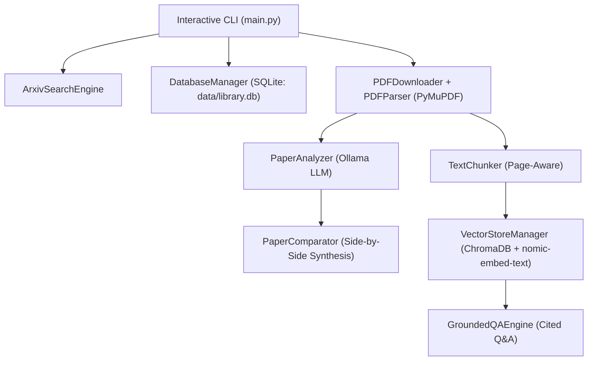

# Litera: Research Paper Intelligence

An end-to-end, local-first AI research assistant built in modular Python. **Litera** searches ArXiv for academic papers, caches and parses PDFs page-by-page, extracts structured technical dossiers, answers questions with verifiable page citations via RAG, compares papers side-by-side, and organizes favorites into persistent SQLite folders.

---

## Features

- **ArXiv Paper Search (`src/search.py`):** Rate-limited, resilient search engine (`ArxivSearchEngine`) supporting relevance/freshness sorting, field modifiers (e.g., `ti:`, `au:`), and automated text normalization.
- **Local PDF Caching & Page-Aware Parsing (`src/downloader.py`, `src/parser.py`):** Stream-downloads PDFs to `data/papers/` (`PDFDownloader`) and extracts hyphen-cleaned, 1-indexed page text using PyMuPDF (`PDFParser`).
- **Structured AI Analysis (`src/analyzer.py`):** Generates executive TL;DRs, problem motivation, proposed methodology, experimental benchmarks, and limitations (`PaperAnalyzer`) enforced via Pydantic JSON schemas and Ollama's expanded context window (`num_ctx=16384`).
- **Grounded RAG Q&A with Citations (`src/chunker.py`, `src/vector_store.py`, `src/qa_engine.py`):**
  - Page-aware overlapping text chunking (`TextChunker`) preserving spatial metadata (`paper_id`, `page_number`, `chunk_id`).
  - Persistent local vector storage using ChromaDB (`VectorStoreManager`) and `nomic-embed-text` embeddings with metadata filtering scoped strictly per paper.
  - Anti-hallucination prompting (`GroundedQAEngine`) that enforces `[Page X]` inline citations and refuses unsupported claims.
- **Multi-Paper Comparative Analysis (`src/comparator.py`):** Uses a Map-Reduce synthesis pipeline (`PaperComparator`) to compare two papers side-by-side across architecture, benchmarks, efficiency, tradeoffs, and practical recommendations.
- **Persistent Research Library & Folders (`src/database.py`):** Production-hardened SQLite database (`DatabaseManager`) with transaction context management, JSON author serialization, full UPSERTs, pagination, and many-to-many folder bookmarking.

---

## System Architecture



---

## Project Structure

```text
Litera/
├── data/
│   └── papers/            # Cached PDF files (gitignored)
├── src/
│   ├── __init__.py
│   ├── models.py          # Pydantic schemas (PaperMetadata, PaperAnalysis, PaperChunk, PaperComparison)
│   ├── search.py          # Rate-limited ArXiv API search client
│   ├── downloader.py      # Streaming PDF downloader & local file cache
│   ├── parser.py          # Page-aware PyMuPDF text extractor
│   ├── analyzer.py        # Structured paper dossier extraction via Ollama
│   ├── chunker.py         # Paragraph & page-aware text chunker
│   ├── vector_store.py    # Persistent ChromaDB + Ollama embedding store
│   ├── qa_engine.py       # Grounded RAG Q&A with [Page X] citations
│   ├── comparator.py      # Multi-paper Map-Reduce comparison engine
│   └── database.py        # SQLite folder & bookmark manager
├── main.py                # Interactive CLI entry point
├── requirements.txt       # Project dependencies
├── .gitignore
└── README.md
```

---

## Tech Stack

- **Language:** Python 3.10+
- **Local LLM & Embeddings:** Ollama (`qwen2.5:8b` / `qwen3:8b`, `nomic-embed-text`)
- **Vector Database:** ChromaDB (persistent local storage)
- **Relational Database:** SQLite (`sqlite3`)
- **PDF Processing:** PyMuPDF (`pymupdf`)
- **APIs & Networking:** ArXiv API (`arxiv`), `httpx`
- **Data Validation:** Pydantic v2

---

## Setup & Usage

1. **Clone the repository:**
   ```bash
   git clone https://github.com/turjosajid/Litera.git
   cd Litera
   ```

2. **Create and activate a virtual environment:**
   ```powershell
   python -m venv .venv
   .venv\Scripts\Activate.ps1  # Windows PowerShell
   ```

3. **Install dependencies:**
   ```powershell
   pip install -r requirements.txt
   ```

4. **Pull the required Ollama models:**
   ```powershell
   ollama pull qwen2.5:8b
   ollama pull nomic-embed-text
   ```
   *(Make sure the model tag configured in `main.py` matches a model listed in `ollama list`.)*

5. **Run the interactive CLI:**
   ```powershell
   python main.py
   ```

---

## CLI Workflow Guide

- **Main Menu:** Choose `[1]` to search ArXiv or `[2]` to open your saved library and folders.
- **From Search Results:**
  - Enter a paper number (e.g. `1`) to generate its technical dossier and launch Grounded Q&A.
  - Type `compare 1 2` to generate a side-by-side comparison matrix between two papers.
  - Type `save 1` to bookmark a paper into an existing or new folder.
- **Inside My Research Library:**
  - Use `new <folder_name>` to create folders, `del <folder_id>` to delete folders, or open a folder to analyze, compare (`compare X Y`), remove (`remove X`), or chat with saved papers.
